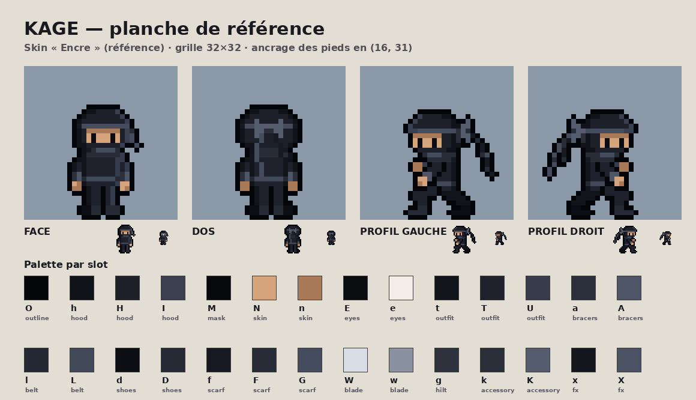

# ninja-video-game

Jeu de plateforme 2D rapide en pixel art. Personnage principal : **KAGE**, ninja noir.



## Lancer le terrain d'essai

```bash
npm install
npm run dev        # http://localhost:5173
npm run build      # version de production dans dist/
npm run standalone # dist/kage-standalone.html : jeu complet en un fichier, jouable par double-clic
```

Commandes : flèches pour courir, double appui rapide sur ← ou → pour le dash, Espace pour sauter, ↓ (ou K) pour glisser, J (ou X) pour le coup de sabre, H pour afficher la hitbox. Boutons tactiles sur mobile (double appui sur Gauche/Droite pour le dash).

## Sprites

```bash
npm run sprites    # régénère assets/characters/kage/ et docs/kage/ (Python 3 + Pillow + numpy)
```

Documentation du personnage, des animations et des skins : [docs/kage/README.md](docs/kage/README.md).

## Structure

- `assets/` : ressources du jeu, servies telles quelles (`characters/kage/…`)
- `src/engine/` : chargement des sprites, skins, animations, entrées
- `src/game/` : joueur (machine d'états), niveau de test
- `tools/kage_forge/` : sources des sprites et outil d'export
- `docs/kage/` : planches de référence et aperçus animés
