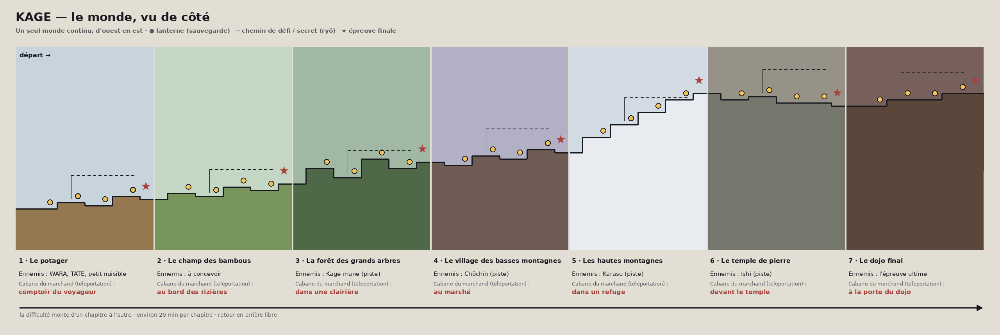

# KAGE — le monde (plan de conception)

> **Statut** : direction validée par l'utilisateur. Le **chapitre 1, le Potager**, est jouable et entièrement peint (voir `docs/REPRISE.md`, § 6 bis et § 6 quater). Les chapitres suivants restent à concevoir ; leurs ennemis sont des pistes, chacun passera d'abord par une planche de design.

---

## 1. Le principe

- **Un seul monde continu**, parcouru d'ouest en est (et parfois vers le haut), sans menu de niveaux : on passe d'un chapitre à l'autre en marchant. C'est le choix de l'utilisateur, et ce qui fera l'originalité de KAGE.
- **Le rythme reste celui d'un jeu de plateforme rapide et exigeant** (esprit Geometry Dash, Celeste) : le monde est avant tout un **long parcours vers l'avant**. On avance, ça accélère, ça se corse.
- **Une touche d'exploration** : à côté du chemin principal, des passages secondaires plus difficiles mènent à des secrets et à des ryō (comme la cache derrière la cascade du Potager). **Jamais obligatoire pour finir le jeu.**
- **Aucune mécanique ne se débloque** : KAGE a **toutes ses capacités dès le début**. Ce qui change au fil du monde, c'est le terrain, les ennemis et l'exigence. Les **attributs** (vie, attaque…), eux, progressent par l'expérience (§ 5).
- **Retour en arrière libre** à tout moment, avec des **points de téléportation** : les cabanes des marchands, une par chapitre.
- **Les lanternes** sont le cœur du système : point de retour après une chute **et** sauvegarde automatique.

## 2. L'histoire (en fond, jamais envahissante)

Proposition : les **talismans** déjà présents (sur TATE, sur WARA) deviennent le fil rouge. Quelqu'un pose des talismans maudits qui réveillent les gardiens, les mannequins et les objets du pays ; KAGE remonte la piste jusqu'au dojo final. Pas de dialogues longs : quelques panneaux, des images, des sons. L'histoire se lit dans le décor. (À confirmer, § 10.)

## 3. Les sept chapitres

| # | Chapitre | Ambiance | Ennemis (pistes) | Cabane du marchand |
|---|---|---|---|---|
| 1 | **Le potager** | jour, champs, paille, montagnes au loin | WARA, TATE, le petit nuisible voleur de légumes | le comptoir du voyageur, à la sortie |
| 2 | **Le champ des bambous** | rizières, bambous, eau | à concevoir | au bord des rizières |
| 3 | **La forêt des grands arbres** | troncs immenses, bambous, brume | Kage-mane (kunaïs) | dans une clairière |
| 4 | **Le village des basses montagnes** | toits, lanternes, marché | Chōchin (lanternes volantes) | au marché |
| 5 | **Les hautes montagnes** | vent, neige, glace, ascension | Karasu (corbeaux) | dans un refuge |
| 6 | **Le temple de pierre** | pierre, mousse, or terni | Ishi (sumo de pierre) | devant le temple |
| 7 | **Le dojo final** | l'épreuve ultime | tous, combinés | à la porte du dojo |

Chaque chapitre est découpé en **zones** (8 pour le Potager), chacune avec une idée de gameplay, séparées par des lanternes ; environ **20 minutes par chapitre** pour une première partie.

## 4. Comment la difficulté monte

- **Une zone = une idée.** Elle la présente sans danger, puis avec un peu de pression ; la zone suivante la combine avec une idée plus ancienne. Le Potager suit ce schéma : avancer, sauter et sprinter, puis le dash, puis tout ensemble, puis les ennemis, la glissade, le sabre, et enfin tout combiné.
- **Les aides contextuelles** n'apparaissent que dans le premier chapitre, au moment où la commande sert.
- **D'un chapitre à l'autre**, la marge d'erreur se réduit : plateformes plus étroites, ennemis plus nombreux, lanternes plus espacées.
- **Des chemins de défi facultatifs**, plus durs, mènent aux secrets.
- **Gabarits mesurés** (sol plat) : saut en course 3,8 cases, en sprint 5,5, course + dash 7 ; hauteur 3,1 cases. Le Potager utilise 6 cases pour un trou à dasher, 5 pour un trou à sprinter, une case de hauteur pour la glissade.

## 5. Progression : expérience, ryō, marchand et skins

**L'expérience (exp)**
- KAGE gagne de l'expérience en jouant (ennemis vaincus, épreuves, secrets).
- L'expérience fait franchir des **paliers**, et chaque palier **améliore un attribut** : vie maximale, attaque, énergie… Ce n'est jamais une nouvelle mécanique : tout le kit de KAGE est là dès le début.
- Le détail des paliers (nombre, coût, effets) reste à régler en jouant.

**La monnaie : les ryō**
- Pièces posées sur le chemin, plus nombreuses sur les chemins de défi et dans les secrets ; une dans chaque caisse brisée.
- Compteur discret sous le stock de shurikens. Les ryō se gardent : ils sont enregistrés aussitôt ramassés.

**Le marchand** (personnage à concevoir en planche de design : vieil homme coloré, grand chapeau, gros sac)
- Une **cabane par chapitre**, qui sert aussi de **point de téléportation**.
- Il vend des **skins de ninja** et des **skins d'armes**, **à plusieurs prix**. Son stock grandit au fil du voyage ; rien ne disparaît définitivement.
- Dans le Potager, la boutique existe déjà en coquille (catégories Apparences, Ressources, Objets, encore vides).

**Les skins** (purement visuels)
- **Tenue de KAGE** : une palette différente sur la même silhouette (système de slots déjà en place, `skins/encre.json`).
- **Armes** : nouveau dessin ou nouvelles couleurs pour la lame et le shuriken, sans changer portée ni dégâts.
- **Prix** (à régler en jouant) : environ 50 ryō pour un article simple, 150 à 300 pour un article rare, un ou deux articles de prestige très chers.

## 6. La sauvegarde

- **Automatique** à chaque lanterne : point de reprise, ryō, caisses brisées, rencontre du marchand, temps de jeu, chutes. Une icône « Sauvegardé » s'affiche.
- **Écran titre** : *Continuer* / *Nouvelle partie*.
- **Enregistrée dans le navigateur** (`localStorage`, clé `kage.save.v1`, avec un numéro de version). Si le navigateur refuse, le jeu continue sans sauvegarde et le signale.
- À venir : skins achetés et équipés, expérience et paliers, secrets trouvés, chapitres débloqués pour la téléportation.

## 7. Comment c'est construit (technique)

- **Chaque chapitre est une carte construite zone par zone** par un petit constructeur (`src/game/chapters/potager.js`) : terrain, décors, aides et zones sont déclarés à la suite, ce qui permet de réordonner ou d'allonger une zone facilement.
- **Dessin** : peint en code, pixel par pixel, une fois au chargement (`src/game/potager/`) : fond en parallaxe, tuiles selon la zone, décors, éléments animés. Chaque futur chapitre aura son propre dossier sur le même modèle (palette, plans de paysage, tuiles, décors).
- **Tests** : chaque trou et chaque passage bas du chapitre a son test de faisabilité (`tests/e2e.cjs`) ; on vérifie aussi qu'ils demandent bien la mécanique prévue.
- **Plus tard** : relier les chapitres en un seul monde (passage de l'un à l'autre, téléportation), carte du monde dans le menu pause, installation sur téléphone.

## 8. Ordre de construction

1. ~~**Chapitre 1, le Potager, en greybox jouable**~~ : fait (écran titre, sauvegarde, zones, aides, ryō, caisses, marchand et boutique en coquille).
2. ~~**Décor du Potager**~~ : fait (refonte visuelle : cadrage 480×270, caméra posée, montagnes, décors peints et animés ; voir `docs/REPRISE.md`, § 6 quater).
3. **Planches de design du Potager** : le marchand (le sage voyageur) d'abord, puis le petit nuisible ; ensuite sons d'ambiance et musique.
4. **Expérience et paliers**, contenu de la boutique (premiers skins).
5. **Chapitre 2, le champ des bambous**, puis les suivants : chacun avec ses planches de design d'abord, son ennemi et sa cabane de marchand.

Chaque étape est mise en ligne sur le site dès qu'elle est fusionnée.

## 9. Décisions prises

- **Un monde unique** plutôt que des niveaux.
- **Sept chapitres** : potager → champ des bambous (rizières) → forêt des grands arbres (avec bambous) → village des basses montagnes → hautes montagnes → temple de pierre → dojo final.
- **Aucune mécanique à débloquer** : toutes les capacités de KAGE sont actives dès le début.
- **Attributs** (vie, attaque…) améliorés par l'**expérience**, par paliers.
- **Retour en arrière libre**, avec téléportation aux cabanes des marchands.
- **Monnaie : les ryō.**
- **Le marchand** vend des skins de ninja et d'armes, à plusieurs prix.
- **Le coup de pied, la marche à bout de souffle, l'énergie à 85 % et le sprint au joystick** sont faits et en ligne.

## 10. Questions encore ouvertes

1. **La durée visée** : environ 20 minutes par chapitre, soit 2 h 30 environ pour une première partie : ça te va ?
2. **L'histoire des talismans** : la garder comme fil rouge ?
3. **Les paliers d'expérience** : quels attributs (vie, attaque, énergie, stock de shurikens…) et combien de paliers ?
