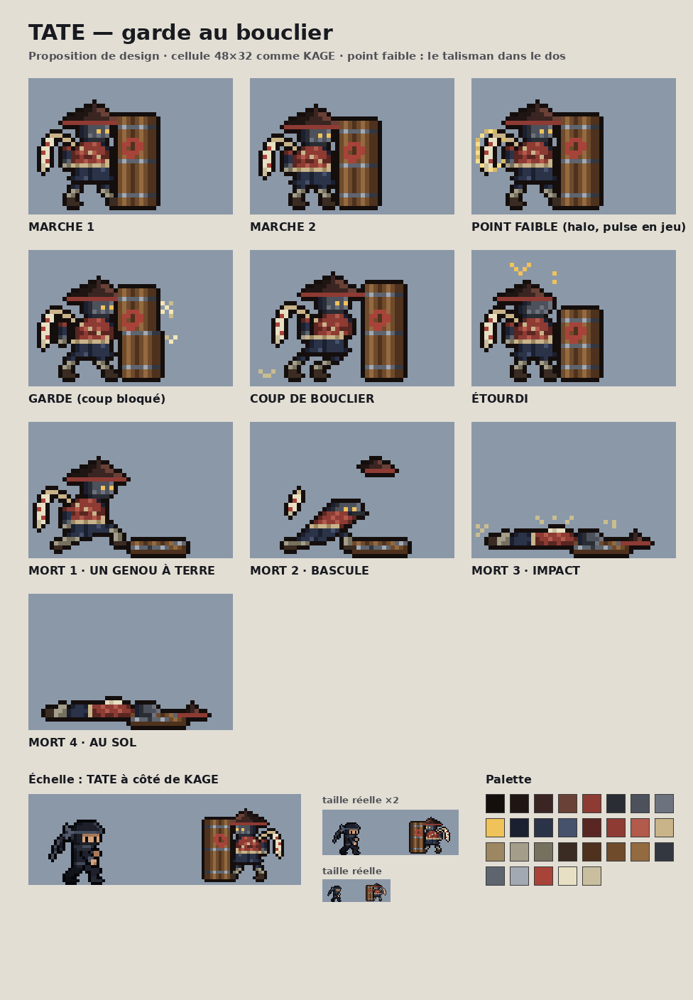

# Ennemis

## TATE — garde au bouclier

Garde de temple trapu, retranché derrière un grand bouclier en bois cerclé de fer. Lent et lourd : l'inverse de KAGE.

**Fichiers**
- Dessin : `tools/kage_forge/enemies/tate.py` (poses pixel par pixel), planche : `tate_board.py`
- Export jeu : `tools/kage_forge/enemies/build_tate.py` → `assets/characters/tate/` (`tate_sheet.png`, `tate_glow.png` pour le halo, `tate.json`). Lancé par `npm run sprites`.
- Comportement : `src/game/tate.js` (réglages dans `TATE`)

**Comportement**
| | |
|---|---|
| Marche | 18 px/s ; ronde autour de son poste, avance vers KAGE quand il le repère (150 px) |
| Demi-tour | 0,7 s : passer dans son dos donne une ouverture |
| De face | bloque tout : sabre → pose de garde + étincelles ; shuriken → rebondit et retombe (récupérable) |
| Corps | solide : KAGE est repoussé, sauf en glissade (il passe entre ses jambes) |
| Coup de bouclier | à moins de 44 px devant lui : élan de 0,45 s (le bouclier tremble), puis charge de 0,32 s (≈ 48 px) ; 2 dégâts à KAGE |
| Esquive | sauter par-dessus à la fin de l'élan, ou glisser sous lui |
| Charge ratée | étourdi 1,4 s |
| Point faible | le talisman dans son dos : son halo pulse quand le dos est exposé (KAGE derrière, ou TATE étourdi). 4 points de vie : 2 coups de sabre ou 4 shurikens |
| Vaincu | mort lourde en 4 temps : un genou à terre (0,6 s), bascule (0,12 s), impact avec poussière (0,22 s), au sol ; puis fondu. Il revient quand KAGE réapparaît |
