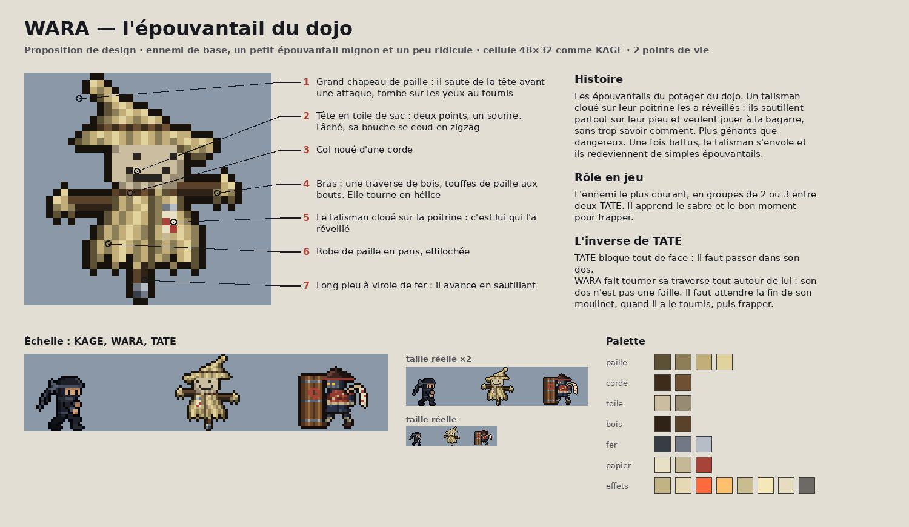
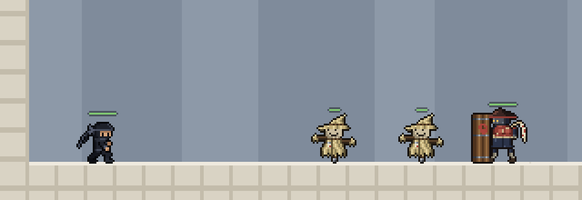
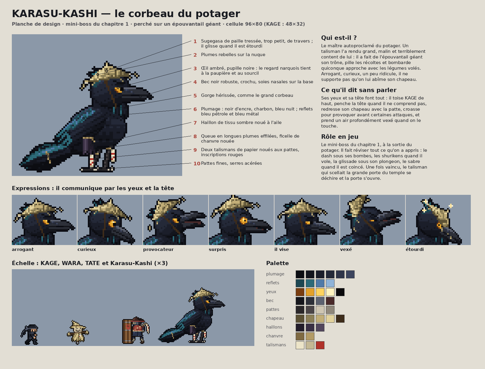
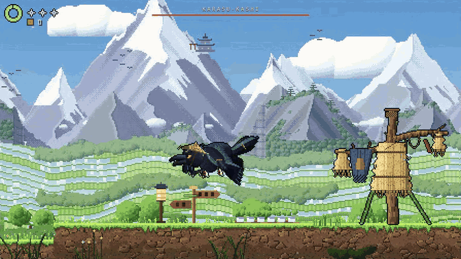
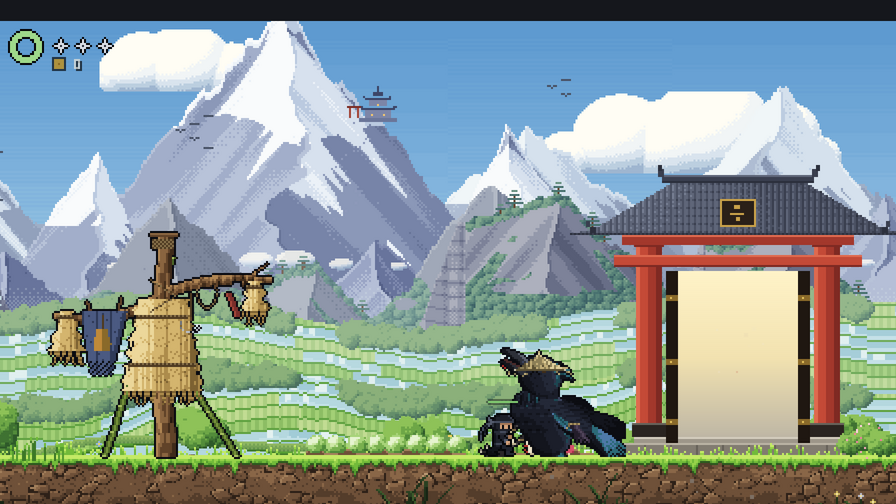

# Ennemis

## TATE — garde au bouclier

Garde de temple trapu, retranché derrière un grand bouclier en bois cerclé de fer. Lent et lourd : l'inverse de KAGE.

**Fichiers**
- Dessin : `tools/kage_forge/enemies/tate.py` (poses pixel par pixel), planche : `tate_board.py`
- Export jeu : `tools/kage_forge/enemies/build_tate.py` → `assets/characters/tate/` (`tate_sheet.png`, `tate_glow.png` pour le halo, `tate.json`). Lancé par `npm run sprites`.
- Comportement : `src/game/tate.js` (réglages dans `TATE`)

**Comportement**
| | |
|---|---|
| Marche | 18 px/s ; ronde autour de son poste, avance vers KAGE quand il le repère (150 px) |
| Demi-tour | 0,7 s : passer dans son dos donne une ouverture |
| De face | bloque tout : sabre → pose de garde + étincelles ; shuriken → rebondit et retombe (récupérable) |
| Corps | solide : KAGE est repoussé, sauf en glissade (il passe entre ses jambes) |
| Coup de bouclier | à moins de 44 px devant lui : élan de 0,45 s (le bouclier tremble), puis charge de 0,32 s (≈ 48 px) ; 2 dégâts à KAGE |
| Esquive | sauter par-dessus à la fin de l'élan, ou glisser sous lui |
| Charge ratée | étourdi 1,4 s |
| Point faible | le talisman dans son dos : son halo pulse quand le dos est exposé (KAGE derrière, ou TATE étourdi). 5 points de vie : 3 coups de sabre ou 5 shurikens |
| Vaincu | mort lourde en 4 temps : un genou à terre (0,6 s), bascule (0,12 s), impact avec poussière (0,22 s), au sol ; puis fondu. Il revient quand KAGE réapparaît |

## WARA — l'épouvantail du dojo

Petit épouvantail réveillé par un talisman cloué sur sa poitrine, mignon et un peu ridicule. Il a un grand chapeau de paille à pointe pliée et une tête en toile de sac (deux points pour les yeux, un sourire, une bouche cousue en zigzag quand il se fâche). Ses bras sont une traverse de bois, il porte une robe de paille effilochée et se tient sur un long pieu. Son chapeau trahit ses humeurs : **il saute de sa tête quand WARA va attaquer** (c'est le signal) et lui tombe sur les yeux quand il a le tournis. Ennemi de base, l'inverse de TATE : sa traverse tourne en hélice tout autour de lui, donc on ne le prend pas à revers ; on le frappe pendant son vertige, après son moulinet. Vaincu, il retombe en tas, la tête et le chapeau par-dessus, et le talisman s'envole.

**Planches**
- [Concept](wara_design.png) : anatomie annotée, histoire, échelle avec KAGE et TATE, palette
- [Toutes les poses](wara_poses.png) : repos, bond, moulinet, vertige, touché, abîmé, mort en 4 temps (18 images)
- [Comportement et parades](wara_gameplay.png) : mise en scène avec KAGE et réglages proposés
- [En situation](wara_en_jeu.png) : captures réelles du niveau 1 avec WARA ajouté à taille réelle
- [Animations](wara_animations.gif)

**Fichiers**
- Dessin : `tools/kage_forge/enemies/wara.py` (pièces assemblées par `figure`, traverse tracée à n'importe quel angle), planches : `wara_board.py`
- Export jeu : `tools/kage_forge/enemies/build_wara.py` → `assets/characters/wara/` (`wara_sheet.png`, `wara.json` ; variantes `_torn` pour l'état abîmé). Lancé par `npm run sprites`, avec contrôles qualité (pieu au sol, couleurs connues, aucun pixel isolé).
- Comportement : `src/game/wara.js` (réglages dans `WARA`), repère `W` dans les cartes.

**Comportement**
| | |
|---|---|
| Déplacement | bonds de 20 px (14 px de haut) vers KAGE dès 120 px ; en ronde de ±40 px sinon |
| Signal | à 30 px : le chapeau saute, bouche cousue en zigzag, il tremblote (0,45 s ; 0,3 s abîmé) |
| Moulinet | 0,5 s, touche des deux côtés à 22 px (1 dégât) ; la traverse pare le sabre et les shurikens |
| Tournis | 0,9 s sans défense, puis 0,6 s avant de pouvoir recommencer |
| Vie | 2 : sabre 2 (un coup), shuriken 1 (il passe abîmé : plus vif) ; un coup interrompt bond et signal |
| Corps | pas solide : KAGE le traverse |

## KARASU-KASHI — le corbeau du potager (mini-boss du chapitre 1)

Grand corbeau d'encre aux reflets pétrole, coiffé d'un **sugegasa de paille beaucoup trop grand** (paille comme celle des WARA, peu dorée : c'est son trait de caractère), haillons, talismans de papier aux pattes. Il règne sur le champ du corbeau (zone 9), perché sur un **épouvantail géant**. Vaincu, il ouvre la **grande porte du temple** : la sortie du chapitre.

**Fichiers**
- Dessin : `tools/kage_forge/enemies/karasu.py` (squelette posable : corps, tête, yeux, bec, ailes plume par plume, queue, pattes, chapeau ; épouvantail, projectiles), planches : `karasu_board.py` (`karasu_design.png`, `karasu_poses.png`, `karasu_arene.png`, `karasu_animations.gif`)
- Export jeu : `tools/kage_forge/enemies/build_karasu.py` → `assets/characters/karasu/` (`karasu_sheet.png` 31 images en cellules 96×80, ancrage (48, 76) sous les pattes ; `karasu_perch.png` l'épouvantail en 5 inclinaisons, 120×140 ; `karasu_items.png` gland et navet ; `karasu.json` animations et boîtes). Lancé par `npm run sprites`, avec contrôles qualité (couleurs, pattes au sol, pixels isolés).
- Comportement : `src/game/karasu.js` (réglages dans `KARASU`) ; arène : zone 9 de `src/game/chapters/potager.js` (`bossDef`) ; porte : `temple_gate` dans `src/game/potager/props.js` (peinture) et `live.js` (`templeLeaves` : battants, corde sacrée, talisman).

**Combat**
| | |
|---|---|
| Attente | perché, il toise KAGE : petites animations de caractère (penche la tête, redresse son chapeau, croasse) |
| Début | KAGE avance de 7 cases dans l'arène : croassement, il s'envole (l'épouvantail tangue et perd de la paille) ; sa barre de vie apparaît en haut |
| Bombardement | il vole bas au-dessus de KAGE et lâche une salve (3, 4 puis 5 projectiles) ; une ombre au sol annonce chaque point de chute. **Gland piquant** : éclate en deux épines qui filent au sol (sauter). **Navet** : mèche de 0,75 s, puis explosion (rayon 26 px). 1 dégât chacun |
| En vol | seul le **shuriken** le touche — lancé au sommet d'un saut |
| Plongeon | il se place à 96 px, plisse le regard (0,85 → 0,55 s selon la phase), replie les ailes et fond en ligne droite vers le sol, juste au-delà de KAGE. Debout : 2 dégâts. **En glissade, on passe dessous** (sa boîte passe à 17 px du sol) |
| Fenêtre | manqué, il s'écrase le bec dans la terre et reste **planté 2,9 → 2,3 s** : le sabre (2), le sabre en l'air (3), le coup de pied (2) et le shuriken le blessent |
| Reprise | il s'ébroue, remet son chapeau, regagne son perchoir, puis recommence |
| Phases | 24 PV ; au-dessous de 66 % puis de 33 %, salves plus longues, lâchers plus rapides, visée plus courte, plongeon plus rapide ; à la fin, il enchaîne deux plongeons quand le premier touche |
| Équité | si KAGE quitte l'arène, il regagne son perchoir et attend ; il ne s'écrase jamais hors de l'arène ; KAGE encore invulnérable (il clignote) : il ne remonte pas, il s'écrase |
| Vaincu | il s'affale ; plumes, cri qui retombe ; 1,3 s plus tard le talisman de la porte se déchire et les deux battants pivotent (1,6 s). La défaite est **sauvegardée** (`bossDefeated`) ; si KAGE meurt avant, le corbeau reprend toute sa vie |

