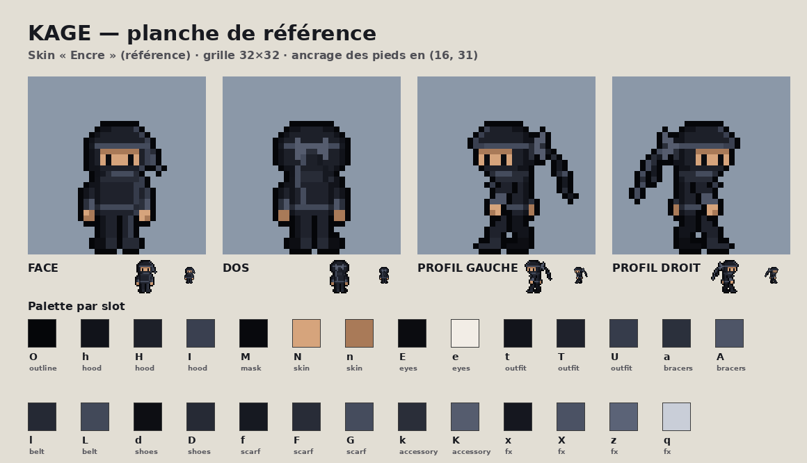

# KAGE — personnage principal

## Design

Ninja du vent, compact et agile. Tête volontairement grande (10 px sur ~24) pour rester lisible à petite taille.

- **Capuche arrondie** avec une visière qui avance au-dessus des yeux.
- **Bandeau de foulard** au niveau du front, **noué en papillon derrière la tête**. Les deux pans partent de ce nœud : c'est l'élément distinctif, celui qui « dessine » le mouvement (il traîne en course, s'étire en dash, remonte en chute).
- **Pans asymétriques** : un long (10 px) et un court (6 px). Leur longueur ne change jamais : seul leur tracé varie d'une frame à l'autre.
- **Bande de visage et mains visibles** (yeux sombres sur la peau), demandées après la première version pour la lisibilité. Le bas du visage reste masqué.
- Tunique courte, ceinture, protections d'avant-bras, chaussures compactes.
- **Sabre** : visible uniquement pendant l'attaque (fourreau supposé caché derrière la hanche).
- **Shurikens** : lancés droit devant, ils retombent et touchent un sol plat à 10 carreaux (160 px) ; ils se plantent dans les murs et le sol et restent dans le décor. KAGE en porte **3 au maximum** (compteur en haut à gauche) : un shuriken planté se ramasse en passant dessus (après 0,3 s), un shuriken qui brise une cible est dévié puis retombe au sol, un shuriken sorti du niveau revient dans le stock, et le stock est rempli à la réapparition. Ils utilisent les couleurs de la lame.

La palette, **Encre**, est entièrement noire et anthracite. La peau est la seule couleur chaude.

## Fichiers (`assets/characters/kage/`)

| Fichier | Contenu |
|---|---|
| `kage_sheet.png` | planche complète : une ligne par animation, cellules 48×32 (personnage dans les 32 premières colonnes, place devant pour le sabre), espacement 2 px, fond transparent |
| `kage_sheet_index.png` | même planche en **carte d'index** : canal R = numéro du slot (voir `kage.json`) |
| `kage_shuriken.png`, `kage_shuriken_index.png` | shuriken : 2 images de rotation, planté dans un mur, planté dans le sol en 2 inclinaisons opposées tirées au hasard à l'impact (cellules 10×10, ancre = point sur la surface) |
| `kage.json` | métadonnées : cellules, ancrage, hitbox, slots, animations (frames, durées, fps, boucle) |
| `kage_views.png`, `views/` | face, dos, profil gauche, profil droit |
| `anims/kage_<anim>.png` | chaque animation exportée seule (bande horizontale) |
| `frames/` | chaque frame en PNG individuel |
| `layers/` | un calque par partie (capuche, masque, peau, yeux, tenue, foulard…) + silhouette |
| `skins/encre.json` | palette du personnage (couleur de chaque slot) |

Aperçus animés de contrôle : `docs/kage/previews/*.gif` · planche annotée : `docs/kage/kage_animations.png`.

## Animations

| Animation | Frames | i/s | Boucle | État de jeu |
|---|---|---|---|---|
| idle | 4 | 6 | oui | immobile au sol |
| run | 6 | 14 | oui | déplacement au sol |
| jump | 4 | 14 | non (reste sur la dernière) | montée |
| fall | 3 | 10 | oui | descente |
| land | 3 | 18 | non | contact avec le sol |
| dash | 5 | 20 | non | dash (double appui ← ← ou → →), 0,25 s |
| throw | 5 | durées par frame (≈ 0,37 s) | non | lancer de shuriken : armé derrière la tête, bras tendu au lâcher (frame 3, point `release`), accompagnement |
| attack | 7 | durées par frame (≈ 0,4 s) | non | coup de sabre : dégainé en fente, demi-cercle devant, rengainé. Zone de frappe active sur les frames 3 à 5 (`hitbox.attack`) |
| slide | 3 | 12 | oui, à partir de la frame 2 | glissade |
| death | 6 | 14 | non | destruction en blocs |
| respawn | 3 | 10 | non | recomposition |

- **Ancrage** : `(16, 31)`, milieu bas de la cellule, sous les pieds. Toutes les frames au sol posent les pieds sur la ligne 31 (vérifié automatiquement).
- **Orientation** : les animations regardent à droite. Pour la gauche, on retourne le sprite (`flipForLeft: true`). L'asymétrie (nœud derrière la tête, pans qui traînent derrière) est relative à l'orientation, donc le retournement reste juste. Seule la vue de référence « profil gauche » est dessinée à part : le pan long y passe du côté éloigné, plus sombre.

## Énergie

Anneau au-dessus de la tête de KAGE (un peu en arrière), qui se vide dans le sens des aiguilles d'une montre et s'efface quand il est plein. Réglages dans `src/game/energy.js` (`ENERGY`).

| Action | Effet |
|---|---|
| Courir | −4 %/s (≈ 25 s de course pour vider la barre) |
| Immobile au sol | +55 %/s après 0,35 s (vide → plein en moins de 2 s) |
| Dash | −33 % (refusé s'il manque de l'énergie) |
| Saut | −10 % (toujours possible, même à vide) |
| Coup de sabre | −12 % (refusé s'il manque de l'énergie) |
| Shuriken | gratuit |

À zéro, KAGE est **essoufflé** : anneau rouge, course à 65 % de la vitesse, dash et sabre impossibles jusqu'à ce que l'énergie remonte à 40 %. Une action refusée fait clignoter l'anneau en rouge. L'énergie est remplie à la réapparition.

## Palette (et futurs skins)

Les skins sont mis de côté pour l'instant. Le jeu n'utilise qu'une palette, `skins/encre.json`.

Chaque pixel est dessiné avec un **slot** (un rôle), jamais avec une couleur, et la couleur de chaque slot vient de cette palette :

| Partie | Slots | Partie | Slots |
|---|---|---|---|
| contour | `O` | protections | `a A` |
| capuche | `h H I` | ceinture | `l L` |
| masque (bas du visage) | `M` | chaussures | `d D` |
| peau (visage, mains) | `n N` | foulard / bandeau | `f F G` |
| yeux | `E e` | nœud (cosmétique) | `k K` |
| tenue | `t T U` | effets (dash, mort, traînée du sabre) | `x X z q` |
| lame du sabre et shurikens | `w W` | poignée et garde | `g` |

Pour changer une couleur : modifier `encre.json` puis lancer `npm run sprites`. La recoloration se fait au chargement depuis la carte d'index (`src/engine/sprites.js`, `applySkin`). Le jour où l'on reprendra les skins, un skin sera simplement un autre fichier de ce type ; les animations n'auront pas à être redessinées.

## Modifier le personnage

Les sprites ne sont pas retouchés à la main dans les PNG : ils sont **générés** par `tools/kage_forge/` à partir de sources texte.

- `rig.py` : pièces dessinées pixel par pixel en ASCII (têtes, torses, pieds, mains, nœud) et outil de pose.
- `art.py` : la pose de chaque frame (coudes, mains, genoux, chevilles, tracé du foulard), les vues, la mort, la réapparition, les vitesses.
- `palette.py` : liste des slots.
- `preview.py` : aperçu agrandi pendant le travail (`python3 preview.py art run`).
- `build.py` : export complet et contrôle qualité (pieds au sol, slots valides, pixels isolés).

Note : les frames 3 à 6 de la mort et 1 à 2 de la réapparition sont calculées à partir de la pose d'impact et de la pose idle (découpe en blocs 3×3, trajectoires fixes). C'est voulu : les blocs doivent provenir exactement du sprite.
